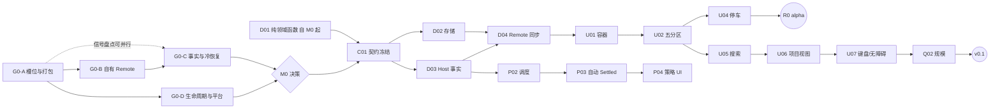

# DeepSeek Harness T3 Sidebar 开发计划

版本：Draft 0.2 · 2026-11-09（修订 2026-11-08 初版；同日记录用户决策 Q1–Q5，见第 10 节）。任务分区为默认和首要交付；同一 v0.1 包含项目视图切换及可配置的时间窗口自动 Settled。本文是待执行计划，未完成项不能作为已验证能力宣传。

## 0. 本次修订要点

| 变化 | 原因 |
| --- | --- |
| D01 纯领域函数与 M0 并行启动，不再依赖 B02 | placement/排序/时间计算不调用任何宿主 API，等 G0 只会拉长关键路径 |
| M0 按风险排序、设 8 工作日时间盒，结束时做显式 Go/缩范围/Stop 决策 | 原计划只写“不通过时修订架构”，没有决策点和降级范围 |
| 新增 C01 契约冻结 | `TaskRecord`、时间策略字段、Remote 方法、存储布局分散在实现 Spec 与时间策略 Spec，且尚未合并（见第 9 节） |
| 自动 Settled 默认开启改为**能力门控** | Host 侧能否看到待审批/队列/子任务尚未证实；看不到时默认开启不安全 |
| 新增 B03（CI 与测试宿主）、S01（设置卡与诊断入口） | 时间策略设置面板和“回退原因诊断入口”在各 Spec 中都没有宿主位置与对应任务 |
| 新增发布分层 R0 → v0.1-preview → v0.1 | 把“可演示”“Web 可用”“双平台正式”分开，Desktop 不阻塞 Web 迭代 |
| 新增 F/A/T 追溯表、待对齐规格清单、待用户决策 | 让每条验收都有负责任务，规格冲突在编码前关闭 |
| 工期由 23–35 调整为 31–45 工作日（单人顺序执行） | M0 含冷读成本测量和自建构建封装；M2 含五分区+原生动作+停车对话框，原估偏紧；Desktop 验收单列为 M6 |
| 记录 Q1–Q5 决策 | 允许浏览器本地降级预览；Linux Web 先行、Desktop 后置；能力不足时自动 Settled 默认 Off；包名 `dsh-t3code-sidebar`；单人开发 |

## 执行状态（2026-11-09，11-11、11-12 更新）

**M0 决策：Go。** 四个验证门在 Linux Web 上通过（G0-C 部分通过，足以支持 v0.1 范围），详见 [M0 验证记录](validation/poc/README.md)。当前代码为 R0 内部 alpha `0.1.0-alpha.0`：单元/服务测试 38 项、端到端 12 项全部通过。

关键实测结论（改变了原计划的假设）：

- **Host 侧事实比调研预期更完整。** `workspace/session-activity` waterfall 给出 turn（含等待审批/回答）、subagent、job、schedule；`session/event` 给出已提交的输入与 turn 起止。自动 Settled 的保护条件可在 Host 上证明，按第 3.2 节**保持默认 7 天开启**。原计划的自定义 `t3SidebarActivity` 投影不再需要。
- **G0-B 走公开 `$mount` + SRC 分派。** Client 挂载手写的 Typert contribution（严格 zod codec），Host 由 Gateway 的 SRC marker 分派并在服务内用同一 schema 校验。SRC 依赖 Host 函数参数名，构建脚本对此做签名守卫。
- **原生 Pin 集合有序**（最近置顶在前），解决第 9 节第 8 项。
- `turn/end` 发出时 Agent 尚未退出 turn，活动需延迟重采样（已实现）。

| 任务 | 状态 | 说明 |
| --- | --- | --- |
| D01 纯领域函数 | 完成 | 分区、排序、Snooze 预设/DST、自动收起判定、命令转换；单元测试覆盖 T01–T05、T07、T09 |
| B01 工程骨架 | 完成 | esbuild 双面构建、Loader 封装、签名守卫、pack 检查、MIT LICENSE |
| B03 测试宿主 | 部分 | 隔离 `DSH_HOME` 安装流程、脚本化模型桩（新增 `#askbash`/`#delaybash`）、测试专用审批夹具 `tests/fixtures/approval-gate`、规模播种 `scale-seed.mjs`、Playwright 脚本；CI 跑 verify，e2e 仍需本机 Harness 运行时，未进 CI |
| C01 契约冻结 v1 | 完成 | `src/contracts` 为单一来源；已回写[实现 Spec §4.0/§5.0](implementation-spec.md) 与[时间策略 Spec §0](time-policy-spec.md)；第 9 节待对齐项全部关闭 |
| B02 / D03 Host 事实 | 完成（v1） | 活动 waterfall、事件折叠、Pin/Archive、会话头索引 |
| D02 存储 | 完成（v1） | `t3_sidebar` 存储域（tasks / transitions / global），CAS、每记录收据、审计上限 1000 |
| D04 同步 | 完成 | baseline + 连续 delta、多窗口一致；2026-11-11（#4）加订阅代次：reset/断档/epoch 变化立即重订阅，旧流与旧代次回复不写状态，非 ready 拒绝写入，回复丢失以原 commandId 恢复 |
| D05 本地后端 | 完成 | localStorage + BroadcastChannel，自动回退并在设置中说明 |
| U01–U04 任务视图与动作 | 完成（alpha） | 五分区、行状态、当前项定位、原生菜单内的 Snooze/已处理/重新打开、自定义时间对话框 |
| U05 搜索与筛选 | 完成 | 标题/工作区即时匹配、正文搜索（防抖、取消与迟到丢弃）；A07 竞态由真实 DOM 组件测试覆盖（`tests/client/sidebar.spec.tsx`） |
| U06 项目视图 | 完成（alpha） | 分组、空项目、新建会话、添加/重命名/移除项目；目录选择用 `pickDirectory` 或路径输入 |
| U07 键盘/无障碍 | 部分 | 方向键/Home/End/左右折叠、Enter 打开有组件测试（A08）；⌘K/⌘O 失效已修复（消费原生注册注入的请求 store），Linux Web 实测通过，**Desktop 待复验**；读屏未验收 |
| S01 设置与诊断 | 完成 | 设置在插件详情页：后端类型与回退原因、被其他插件遮蔽时点名胜出者（`ctx.slots.entries` 最低 priority）、审计记录 |
| P01–P04 时间策略 | 完成（v0.1 范围） | Host 默认/Workspace 覆盖/会话豁免，分范围宽限；保留未确认结果/失败与共享“确认此结果”；`previewPolicy` 草稿预览；见[时间策略 Spec §0](time-policy-spec.md) |
| Q01 | 进行中 | 230 项单元/服务/组件/集成测试；Linux Web 端到端：主场景 20、重启 1、新功能 14 |
| Q03 | 部分 | 真实 Cordis context 上 Client 20 次启停覆盖成功、不兼容、超时和迟到失败。macOS Desktop 已复验真实 Loader 卸载、重装、版本递增升级和回退，停放元数据保留。 |
| Q02 | 部分 | Linux Web 已测量 100 工作区/5000 会话（首屏、视图切换、搜索、语义更新、DOM 行数、堆内存），单列表改为有界窗口；见[验证记录](validation/poc/README.md#2026-11-12-linux-web-复验alpha2)。Desktop 上的预算与 20 次桌面启停待测 |
| R01 | 部分 | [CHANGELOG](../CHANGELOG.md)、[发行说明与支持矩阵](release.md)（门禁核对）已有；npm 包名可用性与正式发布未做 |
| M6 | 部分 | macOS Desktop 0.2.2-rc.1 已通过 #2/#3 的 ⌘Q 重启主线、标题与元数据对照、语义唤醒和到期补算。⌘K / ⌘O 回归已复现。 |

issue #4（2026-11-11）的 A 连接代次、B 装配与失败路径、C 提交与恢复已有自动化证据。E 已修复 pnpm 11 的 frozen lockfile，统一包管理器并启用 CI。Linux Web 已复验真实 Loader 安装、重启与回退。D 已在 macOS Desktop 上复验扫描后新建并停放、十分钟内 ⌘Q 重启的场景。Desktop 其余通过范围和待验项见[验证记录](validation/poc/README.md)。

2026-11-12（`0.1.0-alpha.2`）：审批态端到端、A07/A08 自动化、Workspace 级策略（P01）、结果确认与预览（P04）、S01 诊断、C01 回写、⌘K/⌘O 修复、Linux Web 规模测量均已完成，见[验证记录](validation/poc/README.md#2026-11-12-linux-web-复验alpha2)。

下一步顺序：macOS Desktop 复验 alpha.2（⌘K/⌘O、Workspace 策略、规模预算与 20 次启停，M6）→ A10 guest/权限撤回 → 读屏验收 → v0.1-preview 发布决定。

## 1. 输入、交付物和工作方式

输入为[产品规格](product-spec.md)、[实现 Spec](implementation-spec.md)、[时间策略 Spec](time-policy-spec.md)及[固定上游调研](research/README.md)。第一阶段不是画完整 UI，而是交付能独立安装、调用公开 API、撤销覆盖的最小包，验证架构成立。

v0.1 交付预构建 npm tarball、源代码、锁文件、双语安装/恢复说明、支持版本矩阵、测试报告、GUI 证据及 CHANGELOG。Registry/GitHub 正式发布是实现后的单独发布动作；本次任务只交付规划文档，不发布或初始化远程仓库。

仓库已有 Git 和文档基线（`main`）。按里程碑开分支；各 PR 附关联 F/A/T 编号、实际变化、验证和兼容边界。每阶段合并须可安装、可停用，不能只保持 monorepo 内 link 可用。M0 PoC 代码默认是一次性的，只保留构建封装、pack 检查脚本和能力探测结论，避免把实验性 hack 带进 M1。

开发机为 Linux（WSL2），Linux Web Chromium 是首个验证环境，M0–M5 的 GUI 证据都在这里产生。macOS Desktop 由用户的 Mac 承担，集中安排在 M6，不阻塞 Web preview。npm 包名为 `dsh-t3code-sidebar`（非 scoped），Client Loader id 与 `cordis.patch.yml` 行均使用该名。

## 2. 关键路径与里程碑

关键路径：G0-A → G0-B → G0-C → C01 → D03/D04 → U01 → U02 → U05 → U06 → U07 → Q02/Q03 → R01 → M6。单人开发时没有真正并行，“并行”指同一人在等待宿主实验结果（安装、冷读测量）时插入 D01/B03/fixture UI 等无依赖工作。

按单人（熟悉 TypeScript/React）顺序执行估算，review/QA 不另计人力；不含宿主缺失 API 的上游等待时间。M0 决策后重估。

| 阶段 | 内容 | 依赖 | 工作日 | 阶段出口 |
| --- | --- | --- | --- | --- |
| M0 | 外部插件可行性、兼容基线；D01 并行起步 | 无 | 5–8（时间盒 8） | G0-A/B/C/D 结论、能力矩阵、M0 决策记录 |
| M1 | 契约冻结、domain/storage/Host 事实/Remote、测试宿主 | M0 Go | 4–6 | C01 冻结；分区与并发契约测试通过；Host 重启读回 |
| M2 | 默认任务视图、原生动作、手动 Snooze/Settled、设置卡 | M1 | 6–8 | **R0 内部 alpha**：测试 profile 中可安装演示 |
| M3 | 时间策略与自动 Settled | M2（单人顺序） | 5–7 | T01–T09 通过；能力不足时默认 Off 的路径同样有证据 |
| M4 | 项目视图和完整交互 | M2/M3 | 4–6 | 双视图同状态、项目管理、键盘/主题/窄屏 |
| M5 | 稳定性、性能、Linux Web 验收、预览发行 | M4 | 5–7 | **v0.1-preview（Linux Web）** |
| M6 | macOS Desktop 安装与 GUI 验收 | M5 | 2–3 | Desktop 证据齐全后为 **v0.1** |

合计 31–45 个开发工作日，单人约 7–9 周（v0.1-preview 在第 29–42 天）。若 M0 走浏览器本地降级（第 3.3 节），M1 省去 Remote 部分但增加 D05，总量基本不变。契约在 C01 定稿后再改须同步更新 Spec。外部 Remote/构建或冷状态能力出现缺口时另加修复时间，不能用固定日期代替技术门槛。

## 3. M0：顺序、时间盒与决策

### 3.1 四个强制验证门

按风险与依赖排序执行。G0-A 失败则整个方向不成立，最先做；G0-B 是最大未知；G0-C 的信号盘点可与 G0-B 并行，但“经自有 Remote 承载窄投影”一项依赖 G0-B。

| 门槛 | 建议日程 | 要做的具体实验 | 通过证据 | 不通过时的处理 |
| --- | --- | --- | --- | --- |
| G0-A 槽位与打包 | 第 1–2 天 | 最小 Loader CJS client + 空 Host 入口；单独目录构建 `.tgz`；官方 CLI 装进新 profile；覆盖 `sidebar.workspaces`（priority 可配，默认 -10）；保留 `ui-workspace`；确认 settings card 等设置入口可由插件注册；停用/卸载 | 仅一个赢家；菜单/设置/新会话正常；原生恢复；产物无第二 React；设置入口可用 | 修自身构建/适配；不复制内部组件或改宿主安装文件。仍失败 → **Stop** |
| G0-B 自有 Remote | 第 2–4 天 | Host `TypertRemoteService` + 生成 codecs/descriptors + client mount；owner 请求与 guest 拒绝；断线重连；卸载后句柄失效 | 已发行 runtime 无需重编译就能使用新 namespace；两窗口看到同状态 | 记录最小上游接口需求并提交；按 Q1 进入**浏览器本地降级**（第 3.3 节）。对外明确标注，不把 localStorage 宣称为“Host 持久化已完成” |
| G0-C 事实与冷恢复 | 第 3–6 天 | 外部包注册 `t3SidebarActivity` 投影；未打开会话、冷缓存缺项、权限审批、定时 ask、输入队列、子任务、jobs/schedules、fork、正常/失败/取消/修复 closer；`refreshProjections` 与公开 projections 冷读成本 | 第 3.2 节能力矩阵填满，每格为“已证实 / unknown / 不可用”；稳定 token；冷读成本数字；自有 Remote 可承载窄投影 | 不支持的信号标 unknown 并按第 3.2 节降级；不凭 UI 字符猜测 |
| G0-D 生命周期与平台 | 第 4–7 天 | Linux Web 独立 profile（Desktop 推迟到 M6）；目录 chooser/远程浏览/无能力三分支；`session.search`/`workspace.add` 快捷键冲突；HMR 重入；20 次启停 | 原生服务保留且动作实际有效；停用无泄漏 | 修自身生命周期处理；不能据 Web 结果宣称 Desktop 已通过 |

M0 证据保存在 `docs/validation/poc/`：`runtime/version.json`、pack-contents、脱敏配置、能力矩阵、冷读成本、测试输出与截图。开发环境使用独立 `DSH_HOME`，不读取用户历史或凭据作为测试数据。

### 3.2 能力矩阵与功能门控（G0-C 产物）

每个信号分别记录 Client 实时 / Host 实时 / Host 冷启动三列。实现 Spec §4.2 假设 Host 能从已装配的 approval/userQuestions 能力读到待交互，但调研只证实了 Client `uiSession.sessionStatus` 和 `userQuestions` 投影。**Host 侧能否看到待审批是 G0-C 的必答项**，因为它决定了自动规则的安全性。

| 功能 | 需要 Host 可证实的最小信号 | 信号缺失时的降级 |
| --- | --- | --- |
| Working 分区 | running（Client 实时即可） | 显示“状态待同步”，保留最后可信位置 |
| 完成/失败返回 Active | `t3SidebarActivity` turn/end token | 仅用 `completionUnread` 作即时提示；不跨刷新持久 |
| Snooze 提前唤醒 | 待交互 token（持久唤醒需 Host 侧） | Client 实时审批始终在展示层覆盖 Snooze（“新审批一定可发现”）；持久唤醒退化为仅到期/手动 |
| 手动 Settle 准入 | running、子任务、待交互均在 Host 侧已知 | 返回 `BASELINE_PENDING` 或拒绝，提示原因 |
| 自动 Settled | 上述全部 + 已接受输入/队列 + 计划任务 | 规则仍可配置，但**出厂默认 Off**，设置页显示缺失能力；逐会话跳过并记录原因 |

M0 决策时，若自动 Settled 全部所需信号均在 Host 侧证实，才保持时间策略 Spec 的“默认 7 天开启”；否则以“默认 Off、7 天为建议值”发布，并在 release notes 说明（Q3 已确认）。浏览器本地降级模式下自动 Settled 一律默认 Off。

### 3.3 M0 决策点

M0 结束（或时间盒到期）时，写入 `docs/validation/poc/decision.md`：

| 结论 | 条件 | 后续 |
| --- | --- | --- |
| Go | G0-A/B 通过，G0-C 至少满足任务视图与手动停车所需信号 | 按本计划进入 M1 |
| Go（缩范围：能力缺口） | G0-A/B 通过；G0-C 有缺口 | 按第 3.2 节降级，自动 Settled 默认 Off；进入 M1 并重估 |
| Go（浏览器本地降级） | G0-A 通过；G0-B 失败 | 按 Q1 进入降级模式（下表），同时提交上游接口需求；Remote 可用后切回 Host 存储 |
| Stop | G0-A 不通过 | 整理上游需求提案；不进入 UI 实现 |

浏览器本地降级模式（Q1：暂时接受）：

| 方面 | 处理 |
| --- | --- |
| 存储 | D05 实现 IndexedDB 后端，与 D02 共用同一存储接口、schema 与 CAS/receipt 语义，日后可迁移到 Host domain |
| 多窗口 | 同一浏览器的多个标签用 BroadcastChannel 同步；不同浏览器/设备不共享 |
| Snooze | 到期在浏览器打开时计算，重新打开时补算；浏览器全部关闭期间不唤醒 |
| 自动 Settled | 仅浏览器打开期间评估，默认 Off；保护信号只有 Client 侧，能力矩阵中缺失项照常跳过 |
| 验收 | A04/T06 中“浏览器关闭/Host 重启”部分标为不适用并在 release notes 写明；F04/F05 其余条款照常验收 |
| 对外表述 | “browser-only preview”；不作为 v0.1，Remote 可用后才发 v0.1-preview |

## 4. 可分派实现任务

“里程碑”列是计划完成阶段；前置未满足的任务可以先接 fixture 开工，但不能合并为真实 adapter。

| ID | 具体工作及交付 | 前置 | 里程碑 | 验收 |
| --- | --- | --- | --- | --- |
| D01 | Placement/status/sort/reconcile 纯函数；reason/token 模型；deadline、24h 天、DST、Snooze 预设计算 | 无（先用本地类型，C01 后对齐） | M0 起，M1 完成 | 所有互斥/优先组合、当前轮与历史结果、时间边界测试；fake clock |
| B01 | 包 `dsh-t3code-sidebar`：TS 项目，lint/typecheck/test/build/pack 脚本；Loader CJS client 构建封装；包 exports/peers；`cordis.patch.yml` | G0-A | M0→M1 | 干净目录从 tgz 安装，运行面模块实例正确，pack 内容清单通过 |
| B03 | CI 与测试宿主：固定 Harness 版本的获取方式、隔离 `DSH_HOME`/profile 脚本、fixture provider（无需真实付费 LLM） | G0-A | M1 | CI 从空环境安装 tgz 并跑 contract 测试 |
| C01 | 契约冻结 v1：合并 `TaskRecord` 与时间策略字段、`ActivityFacts`、Remote 方法（任务+策略共 11 个）、错误码、存储布局（state/policy/audit/receipts）与容量预算；关闭第 9 节待对齐项 | M0 决策；D01 草案 | M1 | schema 与 codecs 可生成；Spec 同步更新；待对齐项全部有结论 |
| B02 | 公共 Host/Client adapters 与能力探测；固定版本快照 | C01 | M1 | 缺能力行为可见，禁止私有 import |
| D02 | Storage domain、schema version、command queue、CAS、receipt、审计环形记录 | C01、D01 | M1 | 断电式失败、重复命令、过期 receipt、ABA 保护、容量错误不截断 |
| D03 | Host 小投影、冷基线读取、截点/代次比较、待交互 token | B02 | M1 | 不 retain 全列表；fork/迟到 cold read 不误唤醒；回填并发 ≤2 |
| D04 | typed Remote baseline/delta、鉴权、连接代次 | D02/D03 | M1 | 两窗口一致、断档重建、guest 拒绝、撤权移除 |
| D05 | **仅降级模式**：IndexedDB 存储后端 + BroadcastChannel 多标签同步 + 浏览器内调度，实现与 D02/D04 相同的接口 | G0-B 失败、C01 | M1 | 同一套 contract 测试通过；迁移到 Host 存储的路径有测试 |
| Q01 | 领域/Host fixture、contract/component/e2e 框架、fake clock、A/T 追溯维护 | 自 M0 随 D01 起 | 持续 | 追溯表随 PR 更新；无真实等待 7 天 |
| U01 | 单 slot、双视图容器、normalized store、主题/locale、错误边界回退 | B01；先接 fixture，D04 后切真实 | M2 | 服务/注册清理完整，默认任务视图；渲染错误时原生赢家恢复 |
| U02 | 五分区、行状态、折叠/分页/当前项定位、浏览器已读游标 | U01/D01 | M2 | A01/A02/A08；无重复行、无 token 排序抖动 |
| U03 | 原生会话菜单、创建/重命名/pin/archive/restore | U02 | M2 | A09；归档拒绝/确认准确、无隐式强停 |
| U04 | Snooze/立即返回/Settle/reopen、自有 dialogs | U02/D02 | M2 | A03–A06；运行中可 Snooze、不可 Settle；待审批拒绝 |
| S01 | 插件设置卡（策略面板宿主位置）与诊断入口（未接管槽位时显示原因：API 缺失、非 owner、协议不符） | B01、G0-A | M2 | 停用/回退时诊断可见；不劫持他方注册 |
| U05 | 搜索 + 项目筛选 + 未分组 + 范围外当前项 | U02 | M2→M4 | A07/A08，hasMore、取消和迟到结果测试 |
| P01 | Host/Workspace policy 与 Session override 配置；多 membership 的 `policyWorkspaceId` | D02 | M3 | 值校验、继承/自定义/关闭三态、policy revision |
| P02 | 单 timer + 60 秒兜底 sweep + 事件合并队列；Snooze 到期补算 | D03/P01 | M3 | T04/T06/T08，时钟跳变/停机恢复 |
| P03 | inactivity 锚点、7 天预设、宽限、reopen hold、保护条件、能力门控默认值 | P02 | M3 | T01–T09；`settledEnteredAt` 与活动锚点分离 |
| P04 | 策略设置面板、预览、迁移原因、结果确认 `acknowledgeResult`、审计 `listTransitions` | P01/P03/S01 | M3 | 可看下一期限和跳过原因；关闭后无新动作 |
| U06 | 完整项目视图、Workspace dialogs、目录选择器、快捷键路由 | U03/U05 | M4 | 不复用私有 browser；两视图状态一致；快捷键只触发一个 handler |
| U07 | 键盘/读屏/窄屏/reduced-motion | U02/U06 | M4 | 全操作可不用鼠标，焦点/列表语义正确 |
| Q02 | 5000 会话、50 运行压力；渲染计数/内存/冷读预算 | U07/P03 | M5 | 实现 Spec 第 10 节预算有证据或有记录的调整 |
| Q03 | 安装/升级/回退/卸载/冲突/故障测试 | 全部 | M5 | 旧数据保护、原生可恢复，20 次启停无增长 |
| R01 | 版本矩阵、安装文档、license/notice、发行说明 | Q01–Q03 | M5 | 使用者能从空环境复现，支持范围真实 |

## 5. 追溯：规格编号 → 负责任务

| 规格项 | 主要任务 | 验收用例 |
| --- | --- | --- |
| F01 视图默认与切换 | U01、U06 | A01 |
| F02 五分区 | D01、U02 | A02、A08 |
| F03 运行/交互/失败/未读 | D03、U02 | A02、A10 |
| F04 Snooze | D01、D02、U04、P02 | A03、A04、T04、T06 |
| F05 Settled 手动+自动 | U04、P03 | A05、T01–T05、T07–T09 |
| F06 原生动作 | U03 | A09 |
| F07 搜索/筛选 | U05 | A07 |
| F08 项目视图 | U06 | A01、A08 |
| F09 当前项/键盘/无障碍/主题 | U02、U07 | A08、A12 |
| F10 安装/停用/回退 | B01、U01、S01、Q03 | A11 |
| F11 时间策略设置 | P01、P04 | T02、T07、T12（时间部分） |
| 多窗口/并发/权限 | D02、D04 | A06、A10 |
| 规模 | Q02 | A12 |

## 6. 自动状态迁移的后续功能

| ID | 版本 | 实现内容 | 依赖与出口 |
| --- | --- | --- | --- |
| P05 | v0.2 | Settled N 天归档候选、原因、跳过/豁免、恢复 hold | 不要求原子归档能力，可独立交付预览 |
| P06 | v0.2 条件项 | 可配置自动 Archived（默认 Off） | G-ARCHIVE 通过；条件提交+intent 恢复+不强停，T10/T11 |
| P07 | v0.3 | PR merge/close 各自触发 Settled、Keep PR | 可信身份/时间/多 PR 状态；全部关闭真停，T12 |
| P08 | v0.3 | provider reset Snooze 与可选续跑集成 | resetAt 公开能力；续跑必须独立宿主服务和开关 |
| U08 | v0.2 | DnD、手动排序、批量操作、Undo、关闭 Working | 完全通过菜单等价流程后再加；并发/排序确认不丢行 |
| U09 | v0.3 | Git/PR 装饰与第三方 row 适配 | 不能跨原 slot 渲染授权，不引入 worktree 清理 |

G-ARCHIVE（v0.2）：证明“仍未 pin、仍属于同一 Settled revision、无活动”能在原生归档提交处原子验证。当前接口没有这个完整条件，先做候选提示，详见时间策略 Spec 第 5 节。P06 若仍缺原子能力，release notes 只宣称“自动归档候选”，并列明条件执行未完成。P07/P08 无数据能力时隐藏不可用执行选项，不能凭推测的 PR/限额信息驱动迁移。

## 7. 验证矩阵与发布分层

| 层 | 样本/环境 | 必验内容 |
| --- | --- | --- |
| 领域层 | 确定性合成状态和 fake clocks | 分区、旧/新事件、边界时间、Hold、规则继承、保护条件 |
| Host 层 | 隔离存储、受控失败、同 Host 多 Client | CAS、收据、迁移、掉线回执、baseline 缺口、权限 |
| 集成层 | 实际安装包、固定 Harness 版本（B03） | 装配、Remote 生成、真实投影、原生动作读回 |
| GUI 层 | Linux Web Chromium（M2–M5）；macOS Desktop（M6）；中/英、亮/暗、窄/宽 | A01/A02/A08/A11/A12、策略设置及 T04/T07，实际截图与步骤 |
| 规模层 | 100 项目/5000 会话/50 活跃 | 首屏、搜索、渲染更新、20 次启停、无全历史 retain |
| 发行层 | 空 profile 安装、旧插件 schema 升级、卸载 | tarball 完整性、版本拒绝、回退和配置隔离 |

| 发布层 | 出口条件 | 对外表述 |
| --- | --- | --- |
| R0 内部 alpha（M2 末） | 测试 profile 可安装；任务视图、原生动作、手动 Snooze/Settled；无自动策略 | 不对外；仅用于收集交互反馈与早期性能数据 |
| browser-only preview（仅降级模式） | 同 v0.1-preview，但 A04/T06 浏览器关闭部分不适用 | 明确标注本地存储、不跨浏览器 |
| v0.1-preview（M5） | Linux Web 上 F01–F11、A01–A12、T01–T09、T12 时间部分全部有证据；需要 Host Remote | “Web preview”，列出已验证的运行时版本与平台 |
| v0.1（M6） | 在 preview 基础上 macOS Desktop 安装、卸载与 GUI 验收通过 | Web + Desktop 正式支持 |

GUI 验证按本项目指示使用当前宿主支持的最新正式 Terra，显式指定完整 model ID、High 和 `fork_turns=none`，并记录实际模型。同一 UI 由一位验证代理独占。GUI 通过项应有实际操作证据。

测试可使用 fixture provider，无需真实付费 LLM 调用即可验证大多数状态；少量真实运行验证如需配置测试环境，单独列出。测试中的权限、日志和时间策略不能复用生产会话作为可变样本。

## 8. 风险与收敛措施

| 风险 | 概率/影响判断 | 处理与触发条件 |
| --- | --- | --- |
| 预览版 API 漂移 | 高/高 | 固定基线，adapter 隔离；升级先跑 G0 与 contract tests |
| 外部 client 构建 preset 未发布 | 已确认/高 | 自己维护最小 wrapper（B01），不把仓库内 preset 当 npm 依赖 |
| 外部 Remote 或新投影 codec 缺口 | 未验证/高 | G0-B/C 先证；独立 Remote 携带事实，不改内置 API；失败走浏览器本地降级（D05）并提上游需求 |
| Host 侧看不到待审批/队列 | 未验证/高 | G0-C 必答项；看不到则自动 Settled 默认 Off，展示层由 Client 实时审批覆盖 |
| 冷会话缺缓存或回折代价高 | 已确认可能/高 | unknown 明确、有界预算、按需补齐，不做无界后台扫描 |
| 隐藏原组件导致快捷键/弹窗失效 | 已确认边界/中高 | 自有流程（U06），公共服务复用；G0-D 真实点击 |
| 原生 Pin 与插件停车不同存储 | 已确认/中 | Pin 仅遮蔽，避免跨库清状态；autoarchive 原子门槛 |
| 规则误收起待处理任务 | 中/高 | 保护状态、token 去重、可关闭/hold、原因和恢复；能力门控默认值 |
| 初装旧历史大批自动迁移 | 中/中高 | 默认完整宽限；仅显式追溯设置才处理旧超期项 |
| 三份 Spec 字段与 API 漂移 | 已发生/中 | C01 统一契约后以 `src/contracts` 为单一来源，Spec 引用之 |
| Desktop 问题在 M6 才暴露 | 中/中 | Desktop 与 Web 共用 UI，风险集中在安装与目录 chooser；M6 预留 2–3 天，问题较大时 v0.1 延后、preview 不受影响 |
| 两个替换插件争槽 | 中/中 | 冲突诊断（S01）和可配 priority，不改他方注册 |
| 估时受平台/上游缺口影响 | 中高/中 | M0 时间盒 + 决策后重估，分清 Web preview 与完整 v0.1 |

## 9. 规格待对齐项（C01 关闭）

阅读全部文档后发现以下不一致或空白。C01 负责给出结论并同步回对应 Spec，编码不应基于任一单独版本。

| # | 问题 | 涉及文档 | 建议 |
| --- | --- | --- | --- |
| 1 | （已关闭，见实现 Spec §4.0）`TaskRecord` 缺少时间策略字段（`policyOverride`、`autoSettleHold`、`settledEnteredAt`、`lastSnoozeWakeAt`、`policyEligibleSince`、`effectivePolicyIdentity`、`eligibilityEpoch`、`resultAcknowledgedToken`、settled reason/anchor/deadline） | 实现 §4.1、时间 §2–3 | 合并为一个 v1 schema；settled 分支携带 reason 与审计字段 |
| 2 | （已关闭，见实现 Spec §5.0）Remote 表只有 5 个任务方法；策略相关 6 个（getPolicy/setPolicy/previewPolicy/setSessionPolicyOverride/acknowledgeResult/listTransitions）仅出现在时间 Spec | 实现 §5、时间 §7 | 统一列入实现 Spec 的 API 表，并共享 CAS/receipt/错误码 |
| 3 | （已关闭：拆为 tasks/transitions 表与 global，见实现 Spec §5.0）存储为单个 state 记录（≤16 MiB，receipts 4096 条）；时间 Spec 又加入策略、覆盖和 1000 条/90 天审计 | 实现 §5、时间 §7 | 估算 5000 会话下的体积；审计与 receipts 拆成独立表或环形记录 |
| 4 | 自动 Settled 默认开启 7 天，而调研建议“锁定可读活动来源后再决定是否默认启用” | 时间 §1、调研 t3-time-policies | 已关闭：Host 活动来源已证实，保持默认 7 天开启（能力门控仍保留） |
| 5 | Host 侧待交互权威来源未证实 | 实现 §4.2、调研 harness-state-contract | 已关闭：审批/阻塞提问发生在 turn 内，由 `workspace/session-activity` 的 `turn` 间接可知；turn 结束后仍存在的定时提问经 `sessionController.projections` 精确读取，Client 观察作为下界（实现 Spec §4.0 `PendingSignal`） |
| 6 | 策略设置面板与“独立插件诊断入口”未指定宿主位置 | 实现 §7、时间 §2 | 已关闭：插件详情页（`plugins.bundle.config`）承载设置与诊断（S01） |
| 7 | 平台目标为“Web Chromium + macOS Desktop，Linux Web 后续”，但开发机为 Linux | 实现 §9 | 已决定：Linux Web 为首个验证环境，macOS Desktop 在 M6 |
| 8 | 原生 pin 集合是否承诺顺序未确认 | 产品 §4.5 | 已关闭：`WorkspaceSnapshot.pinnedSessionIds` 为“最近置顶在前” |
| 9 | 多 Workspace membership 的 `policyWorkspaceId` 选择没有 UI 任务 | 时间 §2 | 已关闭：0.2.2-rc.1 中会话至多属于一个工作区（cwd 等于唯一规范路径），无需选择；见时间策略 Spec §0 |

## 10. 已确认决策（2026-11-09）

| # | 问题 | 决定 | 对计划的影响 |
| --- | --- | --- | --- |
| Q1 | G0-B 失败时的方案 | 暂时接受浏览器本地预览 | 第 3.3 节降级模式与 D05；同时提交上游接口需求 |
| Q2 | Desktop 验收 | 用户有 Mac；先做 Linux Web preview，Desktop 后置 | G0-D 去掉 Desktop；新增 M6 |
| Q3 | Host 能力不足时自动 Settled 默认值 | 接受默认 Off | 第 3.2 节能力门控；降级模式一律默认 Off |
| Q4 | npm 包名 | `dsh-t3code-sidebar` | B01、Loader id、patch 行；R01 发布前确认 registry 上该名可用 |
| Q5 | 人力 | 单人 | M3 排在 M2 之后；总工期 31–45 工作日 |

仍待确定：`engines.dsh` 版本范围，在 G0-A 确定实际安装版本后填写。

## 11. 发布验收与回滚

v0.1 需要 F01–F11、A01–A12、T01–T09 及 T12 的通用时间部分通过；v0.2/v0.3 的 T10/T11/能力型 T12 按版本追踪。每个用例记录 fixture 版本、运行时版本、结果与证据，失败项不能以文档审查代替。

发布前检查：无源码私有路径依赖；Host 与 Client 产物齐全；peer/engines 范围经过安装；存储升级可逆；停用不删数据；读到未知 schema 不覆写；许可/来源声明；没有未授权消息发送、模型任务或资源清理。

回滚优先停用插件恢复原生 Sidebar，再切回上一已验证 tarball；保留插件 metadata 备份，禁止删除聊天目录来修复。版本升级只迁移自己的 domain。任何正式发布、启用用户真实 profile 或处理历史会话，都应以当时明确的用户任务范围执行；本规划不提前执行这些动作。
