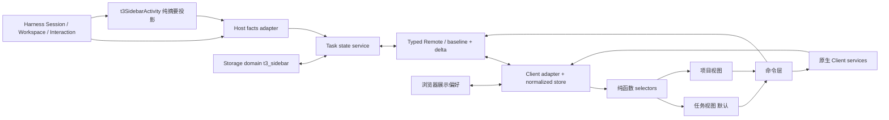

# DeepSeek Harness T3 Sidebar 实现 Spec

版本：Draft 0.1 · 2026-11-08。产品行为以[产品规格](product-spec.md)为准。`t3Sidebar` 命名空间、下列自定义 types/API、目录结构和性能预算均为本项目待实现契约，**不是 Harness 已有功能**。

## 1. 基线和架构决策

固定调研基线：Harness `fcc0ad462172522aaf5c93a7b2e01f6b9f0b0159`，仓库版本 `0.2.2-rc.1`；T3 Code `a9e709f15f825cacac1b6d665fa1920c328d68b7`。Harness 是预览项目，仓库版本不代表用户安装版本或已验证的 npm 发布版本。P0 必须锁定实际安装版本与产物后再填写 `engines.dsh`，不得直接声明支持所有 `0.2.x`。

| 决策 | 选择 | 原因与边界 |
| --- | --- | --- |
| ADR01 | 官方 Cordis 外部 npm bundle | 不 fork Harness、不注入 DOM、不修改用户安装目录 |
| ADR02 | 覆盖 `sidebar.workspaces`，保留 `ui-workspace` | 保留导航、会话菜单、hero picker 等服务；覆盖者自建双视图 |
| ADR03 | TypeScript + React + Harness 公共 primitives | 共享宿主 React/Cordis 实例，主题和 locale 跟随宿主 |
| ADR04 | Host 存插件任务元数据；Client 存展示偏好 | 多窗口和重启后的 Snooze/Settled 可收敛；不重建 Session 数据库 |
| ADR05 | 小型自定义摘要投影 + 原生实时状态 | 避免全会话 retain/history 加载；补齐持久 turn 结果身份 |
| ADR06 | v0.1 单 Host、单 profile、owner-only | 同一 Host 所有者的窗口共享任务整理状态；不把 PeerScope 当持久用户 ID |
| ADR07 | 首版 Working 固定开启；Settled 支持手动与时间策略 | 自动 Settled 首版交付；关闭 Working 的设置进入 v0.2 |

事实依据及精确代码位置见[插件边界](research/harness-plugin-boundary.md)与[状态契约](research/harness-state-contract.md)。

## 2. 模块和数据流



建议单 npm 包、两个运行面，内部按 domain 分层，避免首版拆成多个发行包：

```text
src/
  index.ts                       Host apply/inject
  contracts/                     schema、Remote 输入输出、错误与版本
  domain/                        placement、status、排序、状态转换纯函数
  host/
    service.ts                   串行命令、baseline/follow、权限
    storage.ts                   domain、迁移、幂等收据
    activity-projection.ts       已有日志 → 窄摘要
    harness-facts.ts              公开 Host 服务适配
    wake-scheduler.ts             到期计算和恢复补算
  client/
    index.ts                     slot/locale/shortcuts 生命周期
    adapter.ts                   公共 Client 服务适配
    store.ts                     entities、连接状态、乐观操作
    commands.ts                  原生动作与插件动作
    preferences.ts               视图、折叠、滚动、已读游标
    components/                  TaskView、ProjectView、Row、Search、Dialogs
    locales/                     zh/en
scripts/                         client 构建封装、Remote 生成、pack 检查
tests/                           domain、host、contract、component、e2e
cordis.patch.yml
package.json
```

主渲染不依赖 T3 runtime/store，也不导入 Harness 内部 `src/`。T3 的模型只作需求参照。

## 3. 槽位与公共能力适配

在目标声明出现后注册 `sidebar.workspaces`，使用比原生默认 0 更小的可配置优先级（默认候选 `-10`）。**小数值优先，同一优先级冲突会抛错**。注册项只声明 `t3Sidebar.*` 自有子槽；原生 browser 即使被遮盖仍声明原子槽，不能重新声明或直接渲染它们。

注册的 store、inject callbacks、directory flow 和 row slots 均不继承。导出的 `WorkspaceBrowserProps` 类型不等于可调用原 browser。保留 `ui-workspace` 负责公共服务，但搜索/添加目录快捷键和项目弹窗可能仍指向隐藏的原组件，必须有自己的实现与明确快捷键路由。不能同时触发两个 handler。

| 适配能力 | 真实公开入口 | 实现要求 |
| --- | --- | --- |
| 目录 | `ctx.sessions.list`、`ctx.workspaces.list` | 从 `ids` 枚举，按 `byId` 读取；禁止仅枚举 byId 混入 retain 派生行 |
| 导航与新建 | `ctx.uiWorkspace.openSession/startSession/openWorkspace` | 由宿主维护主视图 retain、草稿和创建复用；不操作内部路由 |
| 置顶/归档 | `ctx.uiWorkspace.pinSession/unpinSession/archiveSession/unarchiveSession` | 原生快照为权威；不在插件表另存 pin/archive |
| 重命名 | `sessions.using(id, {source}, ref => ref.binding.session.rename(title))` 或原生结构化菜单 | 自定义 source 通过声明合并登记，严格释放临时引用 |
| 内容搜索 | `sessions.search(query, signal)`、`searchResultLimit` | 按原生 literal phrase 和 hasMore 契约；结果 request-local |
| 项目管理 | `ctx.workspaces` create/rename/delete/insertBefore 等公开方法 | 自有 dialogs；先校验当前权限，错误处理沿用 Host 结果 |
| 目录选择 | `uiWorkspace.pickDirectory/listDirectory/createDirectory` | 本地 chooser / 远程浏览 / 无能力三分支；不借用原私有 directoryFlow |
| 行菜单 | `ctx.contextMenus` 的 session target | 正确传入目标身份；验证原生 rename/archive 对话框仍可见 |
| 运行/交互 | `ctx.uiSession.sessionStatus`、摘要投影 | 只订阅公共 snapshot；unknown kind 显示通用需处理 |

推荐 Client 以 Cordis `inject` 声明实际消费的服务：slots、sessions、workspaces、uiWorkspace、uiSession、remote、remote.t3Sidebar、locale、layout、contextMenus、shortcuts 及 remoteAccess。最终清单由 P0 typecheck 与装配确定。`dsh.client.inject` 是模块依赖元数据，不保证 apply 执行时序；用服务注入和 `slots.inject()` 控制生命周期。

## 4. 数据模型

### 4.1 身份与快照

`SessionId`、`WorkspaceId` 保持上游 opaque 类型。插件第一次初始化生成并持久化 `installationId`，作用域为这份 Host/profile 插件数据；浏览器缓存键为 `t3-sidebar:v1:<installationId>`。每次 Host 插件激活生成 `epoch`，Client 连接也带本地 generation。不能用工作目录名称、端口或浏览器提供的 userId 作为权威身份。

```ts
// 逻辑契约；实际编译时使用上游 branded types 和项目 schema。
type Placement = 'pinned' | 'active' | 'working' | 'snoozed' | 'settled';
type Known<T> = { known: true; value: T } | { known: false };
type SignalToken = { source: string; identity: string; generation: string };

interface ActivitySummary {
  schemaVersion: 1;
  lineageBoundary: number | null;
  lastUserInputSeq: number | null;
  lastTurnStart: { seq: number; at: number } | null;
  lastTurnEnd: { seq: number; at: number; reason: string } | null;
  lastFailureSeq: number | null;
  lastRelevantSeq: number | null;
}

interface TaskFacts {
  sessionId: string;
  running: Known<boolean>;
  runningChildren: Known<number>;
  pending: Known<readonly { token: SignalToken; kind: string; urgent: boolean }[]>;
  activity: Known<ActivitySummary>;
  freshness: 'fresh' | 'stale' | 'rebuilding';
}

interface TaskRecord {
  sessionId: string;
  revision: number;
  disposition:
    | { kind: 'normal' }
    | { kind: 'snoozed'; until: number; setAt: number; baseline: SignalBaseline }
    | { kind: 'settled'; setAt: number; baseline: SignalBaseline };
  lastReturnAt: number | null;
  lastReturnToken: SignalToken | null;
  // v0.2 分配排序键，v0.1 不接受任意客户端写入。
  orderKey?: string;
}

interface SignalBaseline {
  lineageBoundary: number | null;
  inputSeq: number | null;
  turnStartSeq: number | null;
  turnEndSeq: number | null;
  failureSeq: number | null;
  pendingTokens: readonly SignalToken[];
}
```

常态 UI 的 `TaskSummary` 合并原生 title/workspace、TaskFacts、TaskRecord，并带 placement、attention 标签和 permission flags。按 ID 标准化存储，实体内容不变则保持引用。正文、工具参数、错误堆栈和模型推理不进入插件 metadata。

### 4.2 状态权威

插件 `t3SidebarActivity` 是新增的 SessionProjection，Host 启动 effect await `ctx.sessionProjections.register` 并配置 schema/version，纯折叠已有 `user/message`、`turn/start`、`turn/end`、lineage 边界，`init(header,inheritedEventCount)` 初始化继承边界。仅用户来源输入计入 `lastUserInputSeq`；调度/注入消息区别处理。新增日志类型不被写入，底层聊天记录格式不改变。摘要应小于 1 KiB/会话。`asOfSeq` 属于 Registry 外层水位，不能假设 `wire.view(state)` 自动取得；由 Host exact observation 外层单独携带，投影仅维护 lastRelevantSeq。

独立插件注册新投影不代表宿主已编译的 list/control codec 会保留此键。P0 必须验证；可靠路径是 Host 折叠后由插件自身严格 Remote 发送 `ActivitySummary`，Client 的原生 projectionValues 仅作为已验证后的优化。不能要求用户重编译内置 API 才能安装插件。

`completed` 表示本轮正常结束；`error` 表示失败；`aborted` 是取消；`blocked`、`max-tokens`、`interrupted` 显示需检查；`forked` 及祖先继承结果不作为新完成。未知 reason 保留原值并显示通用“需检查”，不判成功。

冷列表可只含滞后 cache。首次安装先建 baseline，历史完成不制造“刚完成”的通知；已有停车基线与后来真实发生的事件则必须比较，不能把重连统一当首次安装。显式 Snooze/Settle 前必须由 Host 对该会话补齐所需基线；需要重建则返回 `BASELINE_PENDING`，展示“正在同步状态”。优先验证公开 `ctx.sessionController.projections` 的 live/exact cold/migration/provider unavailable 路径，禁止 import history/controller 内部实现。后台回填并发最多 2，单次工作时间预算 2 秒，超时返回 pending 而不宣称 CPU 已被中止；若 provider 无可取消/分段读取能力，停用后台全量回填，仅按需处理并报告成本。结果按捕获的 generation/cut 合并，迟到 cold 结果不得覆盖 live。实际成本是 P0-C 门槛。

待交互的 key 只在其来源与 generation 内比较，绝不与 journal seq 数字相互比较。当前审批立即覆盖停车；持久 userQuestions 用 callId/记录身份比较；非持久请求在重连后不能确认是否同一条时，按“需处理/无法确认”安全返回 Active，不宣称这是可靠的新请求事件。这是明确的异常策略，正常重复帧不应重复唤醒。

`completionUnread` 只作即时补充；跨刷新阅读采用浏览器持久 `lastSeenResultToken`，仅在对应会话主视图可见、结果已同步且窗口有焦点时更新，不能因为行进入 viewport 就标已读。首装对历史结果建立阅读基线；其他浏览器的已读不自动同步。Settled 状态在 owner 窗口间共享，阅读标记不共享。

Host 待交互权威来自已装配的 approval/userQuestions 等公开 Host 能力与 audit/projection，不来自 Client `uiSession`。为每种信号分别表达 known/unknown，未知不等于空集合；未能证明 Host 状态的种类仅作 UI 提示，拒绝对应自动或停车操作。需处理区只使用当前未解决交互和本轮结果：上一轮 failure/new-result 在新 turn 开始后保留历史标记但不阻止 Working。Host 对返回事件持久保存 source/session/lineage/seq 或 request ID token，重复 baseline 不更新 lastReturnAt。

时间策略扩展 `policyOverride/autoSettleHold/settledEnteredAt/lastSnoozeWakeAt/policyEligibleSince/resultAcknowledgedToken` 等字段，见[时间策略 Spec](time-policy-spec.md)。共享 resultAcknowledgedToken 是 owner 主动确认结果的动作，区别于浏览器个人已读。

## 5. Host 命令、Remote 和持久化

新增 `ctx.remote.t3Sidebar` 的逻辑 API：

| 方法 | 输入 | 输出/语义 |
| --- | --- | --- |
| `getSnapshot` | protocolVersion | installationId、epoch、streamSeq、dataRevision、serverNow、capabilities、taskRecords、facts |
| `follow` | AbortSignal，协议版本 | 先 baseline，后有序 delta；重连始终取完整 baseline，不承诺永久 replay log |
| `setDisposition` | sessionId、expectedRevision、commandId、kind、until? | Host 读取真实基线并提交；返回权威 record、dataRevision 和 receipt |
| `reopen` | sessionId、expectedRevision、commandId | 清除停车，记录返回时间；不改原生 archive |
| `refreshFacts` | 至多 20 个可见/选中 sessionId | 有界重建结果/进度，不创建 agent、不执行模型请求 |

协议版本初始为 1。未知版本不注册替换 UI。Remote 的具体生成导出、mount 和调用签名由 P0-B 固化，不能将上表当成当前 `ctx.remote` 已有 namespace。复用 Typert codecs 和 Gateway，不另开 HTTP/WebSocket 端口，不建立无鉴权 JSON API。

统一错误：`UNSUPPORTED_HOST`、`FORBIDDEN`、`NOT_FOUND`、`CONFLICT`（含最新 revision）、`SESSION_ACTIVE`、`PENDING_APPROVAL`、`PINNED`、`PENDING_INPUT`、`PENDING_REQUEST`、`BASELINE_PENDING`、`INVALID_TIME`、`STORAGE_UNAVAILABLE`、`PROTOCOL_MISMATCH`。客户端不得通过 `message` 字符串识别业务错误。数据验证在 Host 执行，包括 ID 存在、archive/pin/运行现状与时间范围，UI 禁用不能替代校验。

写入使用 `ctx.storageDomain` 的自有 domain `t3_sidebar`。v0.1 为单 Host 写入，单个版本化 state 记录容纳 `installationId/dataRevision/tasks/receipts`，通过串行队列提交整个记录，确保一次命令的记录变更和收据一起落盘。先持久化成功，再更新内存并广播。上游 table.update 仅更新已有键，首次初始化走明确 create 路径。配置存储超过 16 MiB 时返回容量错误并保留旧值，不能截断历史；v0.2 根据实际规模拆表。

每命令有客户端生成 UUID `commandId` 和 `expectedRevision`。收据保留最近 4096 条且不超过 7 天；重试同 ID 同 payload 返回原结果，不重复改变 revision；同 ID 不同 payload 拒绝。淘汰后的重试仍受预期 revision 保护；每次接受的命令（包括无效果命令）递增目标 revision，防止旧请求被重新当成新修改。

插件 metadata 与 Harness pin/archive 不在同一事务内，故 v0.1 不做隐式取消置顶后 Snooze 的两次写入。Pin 仅遮蔽 disposition，不清停车；Unpin 后按期限与新事件重算，界面明确这一规则。即使停用/崩溃期间错过 pin→unpin 边沿，也无需重建已丢失的跨库事件。归档本身会清原生 pin，不把此边沿理解为用户要求恢复停车。

归档时忽略停车展示并暂存元数据，冻结停车 timer/reconciliation；归档产生的 stop 尾事件不清除它。恢复后按期限、新活动和原状态一次重算，并重新建立自动规则宽限。Session 确认已删除后 metadata 可保留 30 天 tombstone 再清除；列表暂未到达、权限变化或请求失败均不能作为删除证据。清理后保留最小 incarnation/tombstone 或更换 record identity，防止 revision 归零导致旧命令 ABA；不可将过期 mutation 重放到新记录。Fork 的新 ID 从 normal 开始，不继承父任务停车与阅读记录。

存储 schema 独立版本迁移，备份旧文件/记录后升级；未知更高版本只读并提供回退，不覆盖。停用不删 metadata，卸载不清聊天。清理 metadata 是独立显式操作。

## 6. 状态转换与时钟

`derivePlacement(facts, record, nativeState, now)` 不产生 I/O。Host `reconcile` 根据相同规则产生必要 metadata 转换，Client 纯派生只用于即时呈现，不能把派生结果直接当确认写回。

| 当前停车 | 事件 | 持久处理 | 展示 |
| --- | --- | --- | --- |
| normal | 新运行，无 pending | 无停车写入 | Working；pin 时 Pinned |
| normal | 审批/问答/失败/新结果 | 去重记录 return 原因和时间 | Active；pin 时在 Pinned 显示状态 |
| snoozed | 已有问答重复帧 | 不变 | Snoozed |
| snoozed | 新问答/审批/新失败/用户新输入 | 清停车，更新 return | Active；运行且无 attention 才 Working |
| snoozed | 普通完成、后台普通运行 | 不变 | Snoozed |
| snoozed | 到期/手动唤醒 | 清停车，更新时间 | Active 或 Working |
| settled | 新输入/新 turn/新关注 | 清停车，更新时间 | Active 或 Working |
| 任意 | 断线/缓存缺失 | 不凭缺项清状态 | stale + 最后可信位置 |
| 任意 | 原生归档 | 不把它转成 Settled | 只在归档结果 |
| 任意 | 原生 pin | 只遮蔽，保留停车 | Pinned，保持状态提示 |
| 任意 | 原生 unpin | 按当前真实状态重算 | 返回有效 Snoozed/Settled 或 Active/Working |
| normal | 手动 Snooze | 可运行，但拒绝待审批/未知基线/置顶 | Snoozed |
| normal | 手动 Settle | 校验无运行、无待输入、无未知；保存实际进入时间/原因 | Settled |
| normal | auto-settle deadline 超过 | 重新校验策略/事实/候选guard；保存锚点、实际进入时间、reason、policy revision | Settled |
| settled | 手动 reopen | 清停车并设防再次自动收起 hold | Active |
| archived | 原生 unarchive | 重算停车，建立自动规则宽限 | 当前合格分区 |

Host 策略调度器以 Snooze 和 auto-settle 候选的最早期限安排单个 timer，并作 60 秒到期索引兜底检查；触发后批量提交满足 guard 的到期任务，具体锚点、宽限与调度规则以时间策略 Spec 为准，最长计时分段以避免运行时 timeout 溢出。启动、唤醒、配置重载、连接重建时补算所有到期项。Client 倒计时用 `serverNow` 校准显示，系统时钟大幅跳变后重新采样；不靠 UI 每分钟 ticker 决定实际唤醒。不执行 cron 任务、不给 agent 发消息。

v0.1 可采用最多 500 ms 的无关注结束合并窗口减少闪动；审批/问答/失败不延迟。明确不直接复制 T3 的 provider idle 语义；Harness running 是自己的数据契约。

## 7. 同步、竞态和生命周期

每个插件 follow 流以 `{epoch, streamSeq}` 排序，插件写入另有持久 `dataRevision`。baseline 原子替换；delta 只接受同 epoch 的连续 seq，重复丢弃、断档重取 baseline。断线保留数据并禁用停车写入，显示状态待同步；不把旧 `list.phase=ready` 当作新 generation 已完成。插件和原生目录到达顺序独立，以 join 缓冲待匹配 ID，不创造虚假会话。

Client 侧代次（generation，2026-11-11 落实，见 issue #4）：

- 每个 follow 订阅有一个 generation。`connection/reset`、epoch 变化、seq 断档、本订阅首个 baseline 前的 delta、流结束、命名空间服务被替换/移除、dispose 都开启新 generation；旧流事件和旧 generation 发出的 RPC 回复一律不写当前状态（调用方仍拿到回复结果）。reset 与断档立即重订阅；连续失败（期间没有新 baseline）按退避重试，避免热循环。
- 只有当前 generation 的 baseline 到达后才是 `ready`。非 ready 时后端对任务命令和策略写入统一返回 `BASELINE_PENDING`，菜单项与设置/Snooze 确认按钮同步禁用。
- 合并单调：命令回复与 delta 都不能用较低 record revision 覆盖较高者；策略以 revision 单调采用，较旧回复忽略，同 revision 不同内容视为本地副本不可信并立即重订阅。
- 回复丢失（传输失败或 Gateway 内部错误，无法判断是否已提交）返回客户端专用结果 `UNCONFIRMED`，不报告为“未提交”，并立即重订阅。新 baseline 到达后以**原 commandId 与原 expectedRevision** 重发：已提交则 Host 依收据重放（`replayed: true`），未提交且记录未变则此时生效，记录已变则 `CONFLICT`；结果经恢复通知告知用户，最多重试 5 次后提示无法确认。自动的浏览器观察唤醒（`background`）不进入此恢复，由唤醒调度器按 revision 自行重试（同样受 CAS 保护）。
- 策略写入没有收据，不自动重发：下一 baseline 的策略 revision 仍等于请求的 expectedRevision → 未生效；revision 前进且值与请求一致 → 已生效（与他人同值并发写无法区分，结果相同）；否则 → 已被他处更改。
- 明确在分派前被拒的请求（`gateway/bad-request`、协议不符、HTTP 4xx）确定未生效，直接返回对应错误码而非 `UNCONFIRMED`。

Client 装配：一次 effect 运行拥有一条连接尝试链（AbortSignal 所有者）。Remote 挂载、嵌套 `inject` 作用域（cordis `Fiber`，以 `.dispose()` 释放）、后端、status 订阅、重试计时器都由同一 disposer 释放；失效后才完成的连接会被立即 dispose，迟到的失败不再创建本地后端或订阅。连接失败分类：`missing`（命名空间未出现，或 Web 传输 HTTP 404/405/501——0.2.2-rc.1 上 Host 半边关闭即为 404）、`incompatible`（协议不符 `t3Sidebar/protocol-mismatch`、`gateway/bad-request`、其他 4xx）、`forbidden`（401/403 或权限类错误码）回退浏览器本地预览并在设置中显示原因；`transient`（网络错误、5xx、其他 Gateway 内部错误）只退避重试 Host，不切换到本地预览，避免把任务状态分叉进浏览器。审计（transitions）与 `dataRevision` 是尽力而为的簿记：主记录提交后它们失败不回滚、不把操作报告为失败，审计因此可能有缺口；诊断以任务记录的 `receipts` 与 revision 为准。

订阅先安装再读取/发布初始快照；Host follow 在统一队列中获取 baseline 水位并订阅后续事件，避免 snapshot 与 subscribe 之间的丢更新窗口。限制缓冲，例如 1000 个 delta；消费者落后时结束流并要求全量同步。

UI 操作带 opId；同一会话 disposition 请求串行，失败只回滚该 opId 尚未被新状态替代的乐观值。原生 pin/archive 以宿主回执及快照确认。搜索和 refreshFacts 用 AbortController、generation 防迟到。快捷切换 A→B→A 由 `uiWorkspace` 控制选择，插件不得在旧 Promise 回调重设选中会话。

所有 slots、locale、shortcuts、contextMenus、subscriptions、timers、CSS 注入均有幂等 disposer。Host 停用先拒绝新请求、取消跟随和 timer、排空已接受写入、关闭 domain；Client 停用清理所有订阅/覆盖。渲染错误边界能释放本插件覆盖，原始 slot 回为赢家；模块加载前失败应不触及原注册。API 丢失、非 owner、协议不兼容时不占据主替换槽，保留原生体验并在独立插件诊断入口显示原因。不得劫持别的插件注册来恢复原生。

## 8. 权限和扩展兼容

v0.1 自有 endpoint 保持 Gateway 默认 owner-only；远程连接的 owner 可使用，但共享 guest 不启用任务元数据视图，回退原生。不得从 `principalOf() === undefined` 单独推断调用者已获授权，仍由 Gateway 的实际 invocation/连接边界验证。后续 guest 需为 snapshot、delta、每个 mutation 加资源裁切和撤权移除后才能启用。

原生导航和管理仍按 remoteAccess 的真实 capability 判断，Host 再校验。显示层 title/path/snippet 只作文本，不解释 HTML。日志只记错误码、耗时、计数、不可逆散列 ID；不记正文、目录全路径、token 或请求敏感参数。默认不加遥测上报。

被替换 browser 的 row decoration slots 不能直接继承。首版自带计划任务/子任务等必要摘要显示，自有扩展点使用 `t3Sidebar.row.leading/trailing/menu` 等新命名。旧第三方 row 插件的装饰不保证出现，应在兼容说明列出；宿主全局面板、设置、聊天扩展保持原位。目录选择失败时给出明确错误，不伪造已创建 Workspace。

## 9. 构建、安装和交付

Host 入口 ESM，Client 为上游规定的 `window.__ModuleLoader__.load({id,factory})` lazy CJS 产物；不能直接发布 Vite 页面或普通 ESM 当作 `./client`。仓库内 `clientBundle` preset 尚无公开发行包，项目须按固定官方契约实现自己的小构建封装，并验证 React/Cordis external 实例身份、CSS 清理和动态 chunks 路径。

包必须包含 `dsh.bundle.patch`、`dsh.client.platform: web`、正确的 `./client` 导出以及 typed Remote 生成产物。需共享的 DSH 依赖同时列 peerDependencies 和开发类型依赖；独立第三方包正常 bundle 或声明依赖。`dsh.client.external` 与 Node peers 是两层解析，不能混用。

`cordis.patch.yml` 只增加自身包行，不禁用 `ui-workspace`，不覆盖已有 row 的整块 config。先交付预构建 `.tgz`，避免 Git prepare 的脚本策略成为首轮验证变量。pack 检查：生成 codecs、types、JS、CSS、patch、license 全部存在；不包含 `.env`、绝对开发路径、测试记录或上游整个仓库。

Web 使用新的临时 `DSH_HOME` 和测试 profile，从 web 模板初始化，再 `dsh plugin --profile <test-profile> add <absolute-tarball>`，dump-config 后启动。初始化模板会覆盖目标 profile，因此只能对新建测试名执行。卸载验证使用对应 `remove <package>`。具体初始化和启动命令须依据 P0 选定 CLI 的 `--help` 固化到 README，当前仓库没有可执行安装命令承诺。

Desktop 使用其配套 CLI 和独立测试 profile/用户数据环境验证，不能用 npm CLI 安装成功替代 Desktop 验收。首版目标为 Web Chromium 与 macOS Desktop；Windows/Linux Web 为后续兼容测试。Desktop 未通过时只能标注 Web preview，不能宣称双平台正式支持。

## 10. 性能、测试和完成定义

以下为设计预算，P0/P1 实测后可说明原因调整，不是已达成结果：

| 负载 | 目标 |
| --- | --- |
| 100 Workspace、5000 Session、50 个活跃任务 | 列表只订阅摘要，首次挂载不 retain 所有会话 |
| 列表 DOM | 超过 200 行时虚拟化/有界窗口，常驻行不超过可视区+overscan 150 行 |
| 单条语义状态更新 | 本地 p95 <100 ms 出现在 UI；不能让 5000 行全部重新渲染 |
| 纯标题搜索、视图切换 | 快照已到达后 p95 <100 ms / <150 ms |
| 任务区域首屏 | 宿主目录与插件 baseline 已到达后 <300 ms，不包含 Host 启动/网络时间 |
| 活跃 token 流 | 不逐 token 更新任务分区；分区计算以语义事件合并 |
| 新增 Client 产物 | 排除宿主共享依赖后 gzip 预算 250 KiB；超出须分析 |
| 重复挂载/卸载 20 次 | 订阅/timer/DOM 数归零，无持续增长；metadata 不丢失 |

测试必须覆盖：分区不重不漏、状态笛卡尔组合、重复/乱序/丢帧、冷缓存/首次基线、fork/恢复 closers、多窗口 CAS、落盘成功回执丢失、写失败、到期/时钟跳变、原生 pin/archive 并发、权限撤回、slot priority 冲突、隐藏原 browser 的快捷键和目录操作。补充跨 7 天/跨日/夏令时测试，使用 fake clock 不真实等待。

测试层：Vitest 纯函数/Host 伪服务；组件交互测试；基于独立 tarball+隔离 Host 的契约和 Playwright 集成；真实 GUI 验收。新库的具体版本在实现阶段通过当前官方资料和目标宿主 peer range 选择并锁定，不凭本 Spec 假设已兼容。

GUI 验收按项目指示使用届时主机支持的最新正式 Terra、High、`fork_turns=none`，启动时解析并记录完整 model ID；当前列表候选为 `gpt-6.1-terra`，不把它永久写成“最新版”。同一 UI 由一名验证代理独占，主实现代理只审阅截图、步骤和结果。若偏好工具/模型不可用，应先说明，再按用户授权的替代方案进行。

交付完成条件：P0 gates 通过、F01–F11、A01–A12、时间策略 T01–T09 与 T12 通用时间部分全部有证据；T10/T11及能力型T12按后续版本验收、安装及卸载验证通过、许可声明齐备、运行时版本矩阵明确、未解决问题和支持边界列入 release notes。只有文档或 mock UI 通过不等于插件完成。
