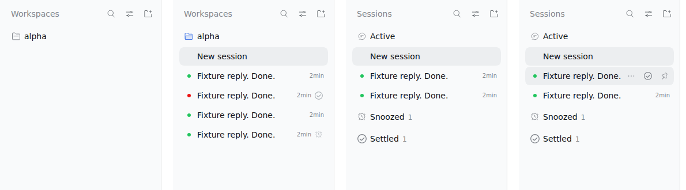

# 原生构图侧栏复验（Linux Web）

记录日期：2026-11-12。被测改动见[原生构图侧栏设计](../../native-sidebar-design.md)。环境与 [M0 验证记录](../poc/README.md)相同：`@deepseek-ai/dsh@0.2.2-rc.1`（npm 发行版）、Linux（WSL2）、Node 24.19、headless Chromium 1243；隔离的 `DSH_HOME` 与新建 `sbtest` profile；模型为脚本化桩 [`tests/fixtures/mock-llm.mjs`](../../../tests/fixtures/mock-llm.mjs)，未调用真实模型，未读取用户 profile。

被测包为 `0.1.0-alpha.1` 预构建 tarball，经 `dsh plugin --profile sbtest add` 安装，安装后的产物与仓库构建逐字节一致。Host 半部未改动，`lib/index.js` 与 2026-11-11 复验的 SHA256 相同（`d09696421e8e…de609`）。

## 结果

`pnpm run verify`：类型检查、150 项单元测试、构建（client 约 40 KiB gzip）、pack 检查全部通过。

端到端（[`tests/e2e/scenario.mjs`](../../../tests/e2e/scenario.mjs)）：main 阶段 20/20、restart 阶段 1/1 通过（[results-main.json](e2e/results-main.json)、[results-restart.json](e2e/results-restart.json)）。控制台中只有 4–5 条 404 资源请求，与 M0 记录相同，并非本插件引起。

| 检查 | 结果 | 说明 |
| --- | --- | --- |
| N01 默认按状态分组 | 通过 | 新 profile 首屏 `data-t3-sidebar="status"` |
| N02 标题行构图 | 通过 | “Sessions” + 搜索、视图选项、添加工作区 |
| N03 空分区不显示 | 通过 | 只有 Active、Working 时不渲染 Snoozed/Settled |
| N04 运行中不提供收起 | 通过 | 运行中的会话行没有收起按钮 |
| N05 归档在 “…” 菜单 | 通过 | 行的 “…” 打开原生会话菜单，含“Archive session” |
| N06 收起按钮 | 通过 | 失败后空闲的会话经悬停按钮进入 Settled |
| N07 取消收起按钮 | 通过 | Settled 行的悬停按钮使其回到 Active，第二个窗口同步 |
| N08 设置在插件页 | 通过 | 视图选项“侧栏设置…”打开插件详情页中的设置区 |
| N09 方向键导航 | 通过 | 行获得焦点时 ↓ / ↑ / Home / End 在分组行与会话行之间移动焦点 |
| N10 键盘可达分组操作 | 通过 | 工作区分组行获得键盘焦点时显示操作条，Tab 进入其 “…” 按钮（搜索结果的取消归档同理） |
| F01 分组方式记忆 | 通过 | 选“单列表”后刷新仍为 `flat` |
| F08 添加工作区 | 通过 | 标题行的添加按钮 → 对话框 |
| A02 / F03 / F04 / A06 / A11 | 通过 | Working、失败可见、Snooze、双窗口 baseline 与 delta、单一赢家 |
| A04 Host 重启保留停放 | 通过 | 重装同版本包并重启 Host 后，Snoozed 与 Settled 仍在 |
| 浏览器本地预览回退 | 通过 | `DSH_T3_SIDEBAR_HOST=off` 下 [`local-backend.mjs`](../../../tests/e2e/local-backend.mjs)：Snooze 刷新后保留；插件页设置区显示“浏览器本地预览 … 原因：Host 任务服务未运行” |

另外在同一 profile 中，从插件详情页关闭本插件后原生 Workspaces 区域立即恢复，重新打开后本插件恢复（[`tests/e2e/showcase.mjs --native`](../../../tests/e2e/showcase.mjs)）。

## 与原生对比

在同一 profile 中关闭本插件截取原生区域，与本插件对比（左起：原生、按工作区、按状态、悬停行）：



几何按已发布 `0.2.2-rc.1` 的原生 CSS 校准，并在同一页面用 DOM 实测：标题行位置、标签与三个图标的 x 坐标、分组行（34px）的位置与原生一致；会话行沿用原生的 32px 行样式。原生标题行末尾有一个零宽的目录选择锚点，它参与 flex 间距，本插件保留了等效的空占位。

| 截图 | 内容 |
| --- | --- |
| [status-en-light](screenshots/status-en-light.png)、[status-zh-dark](screenshots/status-zh-dark.png) | 默认按状态分组（中英文、亮暗） |
| [row-menu-en-light](screenshots/row-menu-en-light.png)、[row-menu-zh-dark](screenshots/row-menu-zh-dark.png) | 悬停操作条与 “…” 菜单（稍后处理、收起、归档） |
| [view-options-en-light](screenshots/view-options-en-light.png) | 视图选项：分组方式、归档筛选、侧栏设置 |
| [workspace-en-light](screenshots/workspace-en-light.png) | 按工作区：Snoozed/Settled 留在原位并带图标 |
| [search-en-light](screenshots/search-en-light.png) | 搜索结果 |
| [rail-en-light](screenshots/rail-en-light.png) | 窄栏：添加工作区与搜索 |
| [settings-en-light](screenshots/settings-en-light.png) | 插件详情页中的设置区 |
| [native-workspace](screenshots/native-workspace.png) | 关闭插件后的原生区域 |

## 复现

```sh
pnpm install --frozen-lockfile && pnpm run verify && pnpm pack
export DSH_HOME=$(mktemp -d)
npx -p @deepseek-ai/dsh@0.2.2-rc.1 dsh sbtest --from-default-profile web --help
npx -p @deepseek-ai/dsh@0.2.2-rc.1 dsh plugin --profile sbtest add "$PWD/dsh-t3code-sidebar-0.1.0-alpha.1.tgz"
node tests/fixtures/mock-llm.mjs 47900 &
DEEPSEEK_BASE_URL=http://127.0.0.1:47900 DEEPSEEK_API_KEY=sk-fixture \
  npx -p @deepseek-ai/dsh@0.2.2-rc.1 dsh --profile sbtest --no-open --port 47821 --host 127.0.0.1
node tests/e2e/scenario.mjs "<带 token 的 URL>" <一个空目录> <输出目录> main
node tests/e2e/showcase.mjs "<带 token 的 URL>" <输出目录>            # 截图
node tests/e2e/showcase.mjs "<带 token 的 URL>" <输出目录> --native   # 原生对比与停用/恢复
```

## 未覆盖

- macOS Desktop 未复验本次界面改动。
- ⌘K / ⌘O 快捷键行为未改变，仍是 macOS 验证记录中的已知问题（原生处理器驱动被隐藏的原生浏览器）。
- 未移植手动拖拽排序与按工作区树分组，见设计 §9。
